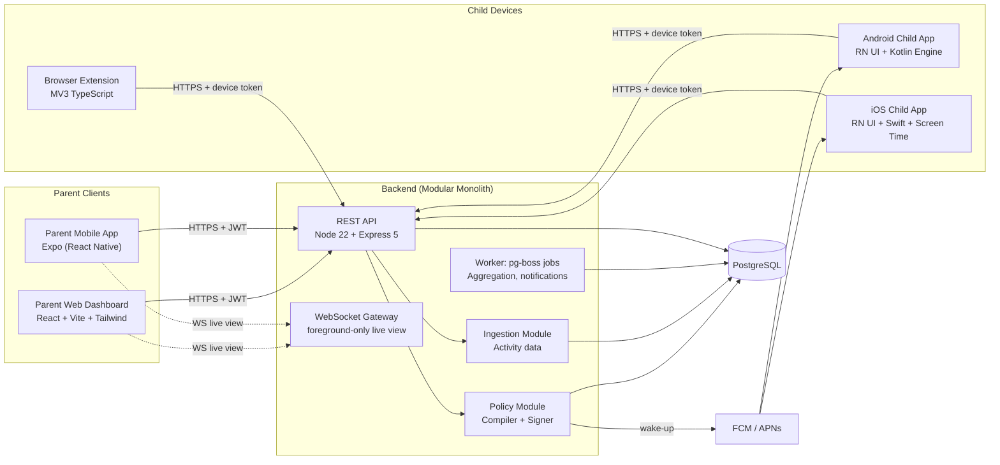
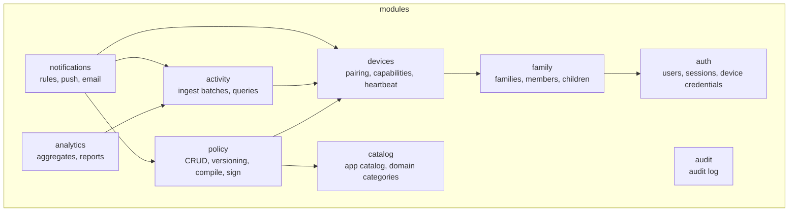
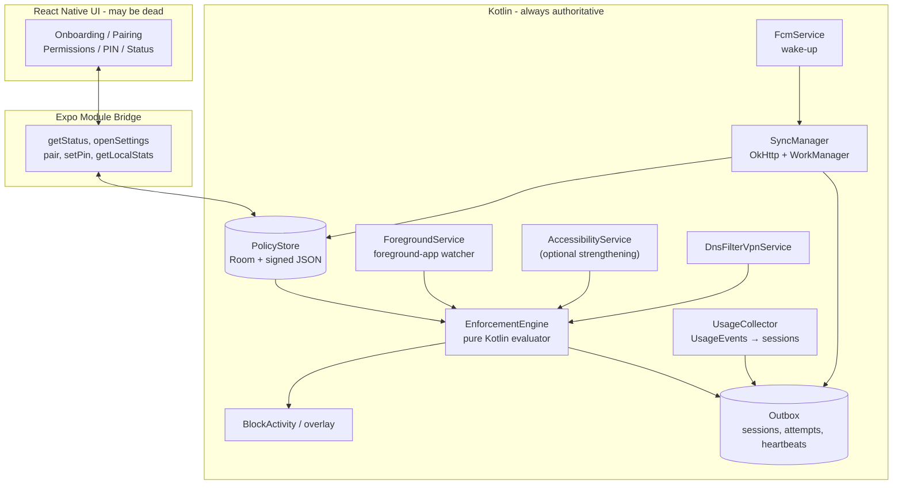
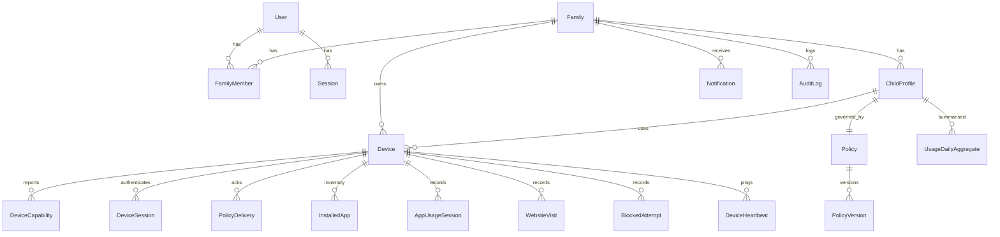
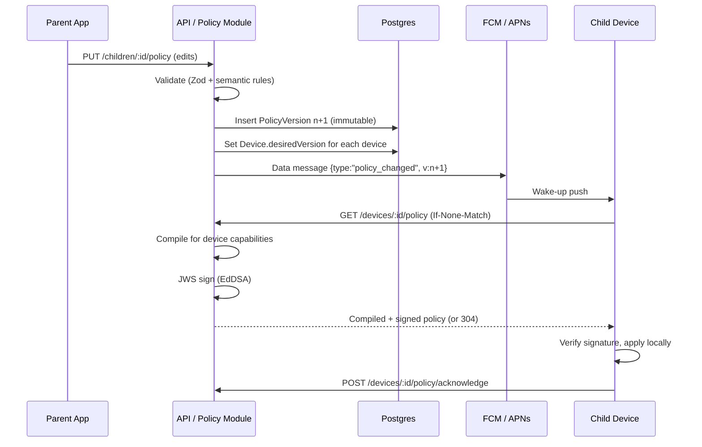
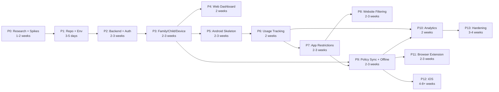

# Guardly — Implementation Project Plan

## Goal Description

Create a comprehensive, **feasible, and cost-minimised** project plan for **Guardly** — a cross-platform parental control ecosystem where parents can link and control what their children view and watch across all devices. The system includes:

- **Mobile apps** (Android + iOS) for both Parents and Children
- **Parent web dashboard** (React)
- **Browser extension** for desktop users (Chrome/Edge/Firefox)

This plan is derived from the existing [PROJECT_BLUEPRINT.md](file:///home/mohit/Projects/studio-brahma/Guardly/docs/PROJECT_BLUEPRINT.md) and [PHASE_0_TECHNICAL_SPIKES.md](file:///home/mohit/Projects/studio-brahma/Guardly/docs/PHASE_0_TECHNICAL_SPIKES.md), distilled with **senior engineering judgment** to produce a document that is actionable, realistic, and sequenced for minimum cost with maximum impact.

---

## User Review Required

> [!IMPORTANT]
> **Key architectural decisions that need your sign-off before implementation begins:**
> 1. **Single child app vs separate Android/iOS apps** — The blueprint recommends merging into one Expo app `apps/child-mobile`. This saves ~40% of UI development but couples iOS and Android lifecycle. Confirm this.
> 2. **No Redis in MVP** — Using pg-boss (Postgres-backed queue) instead. This keeps infrastructure simple and cheap but limits horizontal scaling until later.
> 3. **Children have profiles, not logins** — Devices authenticate as devices, children never get credentials. This is a privacy-first design but changes UX vs competitors.
> 4. **Standard mode limitations** — Android Standard mode (no Device Owner) is bypassable by a determined child. The app *detects and reports* rather than *guarantees*. This must be communicated clearly in the product.
> 5. **iOS will have limited functionality** — Apple's Screen Time APIs deliberately hide raw data. No per-app usage minutes, no browsing history can be sent to your backend. iOS feature set is fundamentally different from Android.

## Open Questions

> [!WARNING]
> **Blocking decisions that must be resolved before Phase 1:**
> - **Product name / bundle IDs**: Apple entitlements are tied to bundle IDs permanently. Choose the final name before submitting the Family Controls request.
> - **Apple Developer Program enrollment**: USD 99/yr — should this be done immediately in Phase 0? The Family Controls distribution entitlement has an **unpredictable approval timeline** (3 weeks to many months). Starting early is critical.
> - **Hosting strategy for demo**: Cloudflare Tunnel from your laptop ($0) vs a small VPS (~$5-7/mo)?
> - **Target Android API**: API 26+ (Android 8+) minimum, API 29+ recommended. Confirm.

---

## 1. Executive Understanding

### What Guardly Is

Guardly is a **parental control ecosystem** where:

1. A **parent** defines rules (app limits, website blocks, bedtime schedules) through a **mobile app** or **web dashboard**
2. Rules are compiled into platform-specific policies and delivered to child devices
3. **Child devices enforce locally and offline** — the phone/browser blocks content even without internet
4. Parents see **real-time status**, usage reports, and alerts when rules are violated or the child attempts to bypass controls

### The Five Engineering Truths (from Blueprint)

| # | Truth | Consequence |
|---|---|---|
| 1 | Enforcement must never depend on the network or JS runtime | Android child app = React Native UI on top of a **pure-Kotlin enforcement engine** |
| 2 | Android gives ordinary apps limited power | Two tiers: Standard (store-installable, bypassable, tamper *detection*) and Enhanced (Device Owner, much harder to bypass) |
| 3 | iOS is a different product, not a port | Opaque tokens, no usage export, no history — accept and design around it |
| 4 | Website blocking on Android is hard | VpnService DNS filtering (bypassable in Standard mode), honest about limitations |
| 5 | Do not build microservices | Modular monolith first — split later when load demands it |

---

## 2. Architecture Overview

### High-Level System Architecture



### Backend Module Architecture



### Android Child Architecture (Critical Path)



**Key Rule**: The Kotlin enforcement engine is the **single source of truth** on the device. It works even when React Native's JS runtime is dead/killed. The UI is just a window into the native state.

---

## 3. Technology Stack (Finalised)

### Backend

| Component | Technology | Rationale |
|---|---|---|
| Runtime | **Node.js 22 LTS** | PERN stack familiarity; Prisma/Express ecosystem |
| Framework | **Express 5** | Async handlers native; no wrappers needed |
| Database | **PostgreSQL** (native, not Docker) | JSONB for policies, partitioning later, 8GB RAM friendly |
| ORM | **Prisma** | Typed queries; hand-written SQL for partitions/indexes |
| Validation | **Zod** | Shared schemas with frontend; type inference |
| Job Queue | **pg-boss** | Postgres-backed; zero extra infra; replaces Redis |
| Auth | **jose** (JWT/JWS) + **argon2** | EdDSA signed tokens; argon2id password hashing |
| Logging | **Pino** + pino-http | Structured JSON logs; redact sensitive fields |
| Push | **firebase-admin** (FCM) | Free; OS-sanctioned wake-up for Android |
| WebSocket | **ws** | Lightweight; foreground-only parent live view |
| Package Manager | **Bun** (install/workspace) | Fast installs; Node 22 for runtime |

### Parent Web Dashboard

| Component | Technology |
|---|---|
| Framework | React + Vite + TypeScript |
| Styling | Tailwind CSS |
| Data fetching | TanStack Query |
| Charts | Recharts |
| State | Zustand (small UI state only) |

### Parent Mobile App

| Component | Technology |
|---|---|
| Framework | Expo (React Native) + TypeScript |
| Navigation | Expo Router (file-based) |
| Data fetching | TanStack Query |
| Token storage | expo-secure-store |
| Push | expo-notifications |
| **Native modules** | **None** (keeps Play review simple) |

### Child Mobile App (Android + iOS)

| Component | Technology |
|---|---|
| UI Layer | Expo dev-build (React Native) |
| Android enforcement | **Kotlin** — ForegroundService, AccessibilityService, VpnService, Room, WorkManager, FCM |
| iOS enforcement | **Swift** — FamilyControls, ManagedSettings, DeviceActivity + extensions |
| Bridge | Expo Modules API (thin, async, idempotent) |
| Native module location | `modules/enforcement-android/` and `modules/enforcement-ios/` |

### Browser Extension

| Component | Technology |
|---|---|
| Standard | Manifest V3 |
| Language | TypeScript |
| Blocking | `declarativeNetRequest` (DNR) dynamic rules |
| Build | Vite + esbuild |
| Targets | Chrome/Edge (MV3), Firefox (event pages) |

### Shared Packages (Pure TypeScript)

| Package | Purpose |
|---|---|
| `shared-types` | DTOs, enums, error codes |
| `validation` | Zod schemas (source of truth for request/response shapes) |
| `policy-contracts` | PolicyDocument types, Compiled* types, golden test vectors |
| `api-client` | Typed fetch client used by dashboard, parent app, child JS, extension |
| `config` | tsconfig bases, biome config |

---

## 4. Monorepo Structure

```
guardly/
├── apps/
│   ├── api/                          # Express 5 + Prisma + ws + pg-boss
│   │   ├── src/
│   │   │   ├── main.ts               # HTTP server + WS
│   │   │   ├── worker.ts             # pg-boss worker entry
│   │   │   ├── config/env.ts         # Zod-validated env vars
│   │   │   ├── http/                 # middleware, error handler, rate limits
│   │   │   └── modules/
│   │   │       ├── auth/
│   │   │       ├── family/
│   │   │       ├── devices/
│   │   │       ├── policy/
│   │   │       │   └── compilers/{android,ios,browser}.ts
│   │   │       ├── activity/
│   │   │       ├── analytics/
│   │   │       ├── notifications/
│   │   │       ├── catalog/
│   │   │       └── audit/
│   │   ├── prisma/
│   │   │   ├── schema.prisma
│   │   │   ├── migrations/
│   │   │   └── sql/                  # partition & raw migration SQL
│   │   └── test/
│   ├── dashboard/                    # React + Vite + Tailwind + Recharts
│   ├── parent-mobile/                # Expo (no native modules)
│   ├── child-mobile/                 # Expo dev-build: ONE app for Android + iOS
│   │   ├── app/                      # Expo Router screens
│   │   ├── modules/
│   │   │   ├── enforcement-android/  # Kotlin: Expo module + services + engine
│   │   │   └── enforcement-ios/      # Swift: Expo module + extension sources
│   │   ├── plugins/                  # config plugins (manifest entries)
│   │   └── app.config.ts
│   └── browser-extension/            # MV3 TS → chrome/ edge/ firefox/ targets
├── packages/
│   ├── shared-types/
│   ├── validation/
│   ├── policy-contracts/
│   ├── api-client/
│   └── config/
├── infrastructure/                   # docker-compose.yml, deploy scripts
├── docs/                             # All .md docs, ADRs, spikes
├── .github/workflows/
├── package.json                      # Bun workspaces root
├── biome.json
└── .node-version                     # 22
```

---

## 5. Database Design

### Core Entities (26 tables)



### Key Design Decisions

| Decision | Rationale |
|---|---|
| **UUIDv7 primary keys** | Time-ordered for good index locality |
| **`familyId` on every tenant table** | Cheap authorisation checks; every query scoped by family |
| **Typed activity tables** (not generic event blob) | `AppUsageSession`, `WebsiteVisit`, `BlockedAttempt` — index well, query well |
| **`UsageDailyAggregate` for dashboards** | Dashboards never scan raw sessions; aggregates pre-computed |
| **No partitioning at MVP** | Plain tables fine until tens of millions of rows; schema designed for partition-readiness |

### Retention Defaults

| Data | Retention | Reason |
|---|---|---|
| Raw sessions | 90 days | Storage cost vs analytics value |
| Website visits | 30 days | Privacy minimisation |
| Blocked attempts | 90 days | Parent needs to review patterns |
| Heartbeats | 7 days (raw) | Only `Device.lastSeenAt` matters long-term |
| Aggregates | 2 years | Trend reporting |
| Audit log | 1 year | Security requirements |

---

## 6. Policy Engine (The Core Innovation)

### How Policies Flow



### Platform-Specific Compilation

The **same parent policy** compiles into different device-specific configurations:

| Platform | Compiled Form |
|---|---|
| **Android** | App blocks by package name, per-app/total limits in seconds, schedules as UTC intervals, DNS blocklist hash set, always-allowed packages |
| **iOS** | FamilyActivitySelection blobs, DeviceActivitySchedule descriptors for 7 days, threshold events, `unsupportedRules` list |
| **Browser** | DNR rule JSON (id, priority, condition.requestDomains, action), static category rulesets |

### Offline Enforcement

Devices cache the last signed policy locally. If the device is offline for days:
- Cached policy remains enforced
- `validUntil` field controls how long to trust the cache
- `failMode` determines behaviour when policy expires without renewal (`ENFORCE_CACHED` vs `ALLOW_ALL` vs `BLOCK_ALL`)

---

## 7. Security & Privacy Design

> [!CAUTION]
> This product processes **children's activity data**. Privacy is a **feature requirement**, not a compliance afterthought.

### Authentication

| Concern | Implementation |
|---|---|
| **Parent passwords** | argon2id, ~100-250ms on server, per-user salt |
| **Parent tokens** | 15-min access JWT (EdDSA) + rotating opaque refresh token (hashed SHA-256) |
| **Device tokens** | 60-min JWT + rotating refresh; stored in Android Keystore / iOS Keychain |
| **Reuse detection** | `tokenFamily` — any reuse revokes the entire family of tokens |
| **Pairing** | 8-char Crockford code, hashed, 10-min TTL, max 5 attempts, single-use |

### Data Isolation Invariant

**Every repository query is parameterised by `familyId` derived from the authenticated principal's memberships, never from client input.**

Automated "IDOR sweep" tests in CI: for every endpoint, a second family's token against the first family's IDs must return `404`.

### What Is Explicitly NOT Collected

- ❌ Keylogging
- ❌ Screenshots
- ❌ Message/call/SMS content
- ❌ Microphone/camera access
- ❌ Location tracking
- ❌ Hidden/stealth mode
- ❌ Full URLs (domain-level only)

### Anti-Stalkerware Stance

The app has a visible launcher icon and persistent notification. The child sees what is monitored. A transparency screen on first run explains all data collection. ToS prohibits use on non-consenting adults.

---

## 8. Cost Analysis (Minimum Viable Budget)

### Development Phase ($0-$25)

| Item | Cost | Notes |
|---|---|---|
| Existing laptop + phone | $0 | 8GB RAM, Ryzen 3 5300U, physical Android device |
| Google Play Console | **$25 one-time** | Required for Play Store listing |
| Postgres | $0 | Native install via dnf (not Docker) |
| FCM push notifications | $0 | Free forever |
| IDE/Tools | $0 | VS Code + Biome + open-source tooling |
| CI/CD | $0 | GitHub Actions free tier |

### Demo Phase ($0/month)

| Item | Cost | Notes |
|---|---|---|
| Backend hosting | $0 | **Cloudflare Tunnel** from your laptop |
| Frontend hosting | $0 | Cloudflare Pages (generous free tier) |
| Database | $0 | Local Postgres exposed via tunnel |
| Email | $0 | Console output in dev; free SMTP tier for demo |
| Push | $0 | FCM free |

### Private Beta ($12-30/month)

| Item | Cost | Notes |
|---|---|---|
| Backend VPS | ~$5-7/mo | Small Hetzner/DigitalOcean droplet |
| Managed Postgres | ~$0-19/mo | Neon free (0.5GB) or $19/mo for growth |
| Frontend hosting | $0 | Cloudflare Pages |
| Domain + TLS | ~$10/yr | Required for production |
| Email | ~$0-5/mo | Free tier transactional provider |
| Monitoring | $0 | Sentry free tier (5k errors/mo) |

### iOS Development (Additional, When Ready)

| Item | Cost | Notes |
|---|---|---|
| Apple Developer Program | **$99/year** | Required for entitlements and TestFlight |
| Mac access | **Variable** | Used Mac Mini (~$400-600) or cloud rental |
| Physical iPhone | **Variable** | Required for Screen Time testing |

### Total Minimum Cost to MVP

| Phase | Cumulative Investment |
|---|---|
| Development → Demo (Android + Web + Extension) | **~$25** |
| Private Beta (first 6 months) | **~$100-200** |
| Adding iOS | **+$500-800** (Mac + Apple program) |

---

## 9. Development Roadmap

### Phase Dependency Graph



### Detailed Phase Breakdown

---

#### Phase 0 — Research & Technical Spikes (1-2 weeks)

**Objective**: Retire the biggest technical unknowns before writing product code.

**Deliverables**:
| Spike | What It Proves |
|---|---|
| **S-AND-1**: UsageStatsManager | Whether `UsageEvents` gives reliable foreground transitions on your device/OEM |
| **S-AND-2**: Block screen | Most reliable method (Accessibility vs overlay) + latency measurement |
| **S-AND-3**: Foreground service survival | 24h persistence test; OEM battery behavior |
| **S-AND-4**: VpnService DNS | Minimal DNS filter intercepting UDP/53; DoH bypass behavior |
| **S-AND-5**: Expo native module | Kotlin↔RN bridge via `create-expo-module --local`; dev-build on Linux |
| **S-WEB-1**: DNR extension | MV3 extension blocking a domain via dynamic rule, persistent across restarts |
| **S-PLAY-1**: Play policy audit | Compliance checklist for Accessibility, VPN, foreground service, QUERY_ALL_PACKAGES |

**Parallel**: Submit Apple Developer enrollment + Family Controls distribution entitlement request (if iOS is planned).

**Acceptance**: S-AND-1..5 produce working demos on physical phone. Written go/no-go for each approach.

---

#### Phase 1 — Repository & Development Environment (3-5 days)

**Objective**: Reproducible workspace that builds on 8GB RAM.

**Tasks**:
- Create monorepo with Bun workspaces (§14 structure)
- Configure Biome, TypeScript bases, `.editorconfig`, commit hooks
- Set up native Postgres (dnf, not Docker)
- Create all shared packages; verify Metro workspace resolution
- CI skeleton (GitHub Actions: lint + typecheck)
- Write `DEVELOPMENT_SETUP.md`

**Acceptance**: Fresh clone → running within 30 min; peak RAM during native build < 6.5 GB.

---

#### Phase 2 — Backend Foundation & Authentication (2-3 weeks)

**Objective**: Secure, tested API skeleton.

| Milestone | Deliverable |
|---|---|
| M2.1 | Server bootstrap + `/health` + error handler + request IDs |
| M2.2 | Prisma setup + migrations + test DB harness |
| M2.3 | argon2id hashing, JWT (jose), refresh rotation + reuse detection |
| M2.4 | Auth endpoints (register/login/refresh/logout/reset) + rate limits + audit |
| M2.5 | Integration tests (all auth flows) |

**Key Endpoints**:
- `POST /auth/register` — Create user + optional first family
- `POST /auth/login` — Password login → access + refresh tokens
- `POST /auth/refresh` — Rotate refresh token (reuse detection!)
- `POST /auth/logout` — Revoke refresh family
- `POST /auth/password/forgot` + `/reset` — Email recovery flow

**Acceptance**: All auth tests pass; refresh reuse revokes family; secrets absent from logs.

---

#### Phase 3 — Family, Child & Device Management (2-3 weeks)

**Objective**: Multi-tenancy + device pairing + thin policy slice.

| Milestone | Deliverable |
|---|---|
| M3.1 | Family + child CRUD |
| M3.2 | Pairing (hash, TTL, attempts, atomic consume) |
| M3.3 | Device auth middleware (device JWT) |
| M3.4 | Capability reporting + heartbeat |
| M3.5 | Policy skeleton (GET/PUT, reduced document) |
| M3.6 | IDOR sweep test harness |

**Pairing Flow**:
1. Parent creates pairing code → server generates 8-char code, stores hash, 10-min TTL
2. Child device enters code → submits with device descriptor + push token
3. Server consumes atomically → issues device credentials + initial policy
4. Parent sees "Device X paired" via push/WS

**Acceptance**: Two-family isolation sweep passes; pairing race test passes; revoked device gets `401 DEVICE_REVOKED`.

---

#### Phase 4 — Parent Web Dashboard Foundation (2 weeks)

**Objective**: First real parent UI — used to drive every later phase.

**Features**:
- Auth screens (login/register)
- Family/child management
- Pairing screen (QR code display + manual code)
- Device list with online/offline status
- Simple policy editor (daily limit, app block list)
- Notifications stub

**Tech**: Vite + React + Tailwind + TanStack Query + `api-client` package + cookie-based refresh tokens (HttpOnly, Secure, SameSite=Strict).

**Acceptance**: Full flow: register → add child → generate code → see device → edit policy → version increments.

---

#### Phase 5 — Android Child App Foundation (2-3 weeks)

**Objective**: Real Android app that pairs, stores credentials, heartbeats, and fetches policy.

| Milestone | Deliverable |
|---|---|
| M5.1 | Expo module scaffold + manifest config plugin |
| M5.2 | Pairing flow (code entry, secure credential storage) |
| M5.3 | Kotlin networking (OkHttp) + token refresh |
| M5.4 | Room schema + PolicyStore |
| M5.5 | Heartbeat worker (WorkManager, 15-min interval) |
| M5.6 | Permission detectors → capabilities report |
| M5.7 | Foreground service skeleton with persistent notification |

**Critical**: The Kotlin `SyncManager` runs via WorkManager, not the JS runtime. Sync survives JS death.

**Permission Guide Screens** (deep-linked to system settings):
1. Usage Access
2. Overlay permission
3. Notification permission
4. Battery optimisation exemption
5. VPN (later phase)

**Acceptance**: Device appears ACTIVE on dashboard; heartbeat arrives every ~15 min with screen off; app survives swipe-away.

---

#### Phase 6 — Native Android Usage Tracking (2 weeks)

**Objective**: Accurate, uploaded usage data visible on the dashboard.

**Core Component — `UsageCollector`**:
- Reads `UsageEvents` (ACTIVITY_RESUMED/PAUSED)
- Builds closed foreground sessions
- Handles screen-off, task switches, split-screen, duplicates
- Stores in Room outbox → batch uploads to API (gzip, backoff, jitter)

**Server-Side**:
- Ingest endpoint + `IngestBatch` idempotency
- Aggregation job (pg-boss) → `UsageDailyAggregate`
- Dashboard "Today" chart

**Acceptance**: Device total within ±2% of Digital Wellbeing; replaying batches creates no duplicates; midnight-spanning sessions split correctly.

---

#### Phase 7 — Android Application Restrictions (2-3 weeks)

**Objective**: Local enforcement of app blocks, per-app/total limits, schedules.

**Core Component — `EnforcementEngine` (pure Kotlin, unit-testable on JVM)**:
```
evaluate(policy, now, usageSnapshot, appId?) → Decision
```

**Features**:
- App blocking (foreground detection → block screen in <500ms)
- Per-app daily limits
- Total daily screen time limits
- Bedtime/school schedules (including cross-midnight)
- Temporary exceptions ("+30 minutes" from parent)
- Time-tamper detection (clock/timezone change → alert parent)
- Blocked-attempt outbox → parent push notifications

**Acceptance**: Block screen ≤500ms; limits accurate ±30s; schedules trigger ±10s; tamper detected within 10s.

---

#### Phase 8 — Android Website Filtering (2-3 weeks)

**Objective**: Domain/category blocking via local DNS VpnService.

**How It Works**:
1. `DnsFilterVpnService` intercepts all UDP/53 traffic
2. Parses DNS queries, checks against blocklist (trie/hash set)
3. Blocked → responds with NXDOMAIN
4. Allowed → forwards via protected socket to upstream DNS

**Limitations (Documented Honestly)**:
- Child can turn VPN off in Standard mode (detected, parent alerted)
- DoH/Private DNS in browsers can bypass (mitigation: block known DoH endpoints)
- Only one VPN app active at a time
- DNS filtering sees domains only, not URL paths

**Acceptance**: Blocked domains return NXDOMAIN; YouTube/Maps/WhatsApp continue; memory <30MB with 5 category lists; VPN-off detected.

---

#### Phase 9 — Policy Sync & Offline Enforcement (2-3 weeks)

**Objective**: Production-grade synchronisation.

**Features**:
- Policy compiler (Android) + JWS signing (EdDSA, `kid` header)
- `If-None-Match` / `304` for cache-friendly polling
- FCM data messages for wake-up
- `desired/applied` version tracking + acknowledgement
- Rollback protection (reject older versions)
- `validUntil` / `softRefreshAfter` for cached policy
- Emergency lock/unlock
- Parent WebSocket live status
- Drift detection + alerts

**Acceptance**: Policy applied ≤30s with FCM; ≤20 min without; tampered payload rejected; 24h offline enforcement works.

---

#### Phase 10 — Analytics & Reporting (2 weeks)

**Objective**: Trustworthy reports parents actually want.

**Dashboard Features**:
- Today's screen time by hour
- 7-day trend by day
- 30-day trend
- Top apps by usage
- Category split (via AppCatalog seed ~300 popular apps)
- Blocked attempts report
- Website activity panel (separate from app screen time)

**Backend**:
- Category aggregates via AppCatalog
- Notification rules (limit reached, permission lost, device stale)
- Retention purge jobs
- Data export / delete child data

**Acceptance**: Aggregation never double-counts; dashboards read only aggregates (verified via EXPLAIN); retention job tested.

---

#### Phase 11 — Desktop Browser Extension (2-3 weeks)

**Objective**: Chrome/Edge website control; Firefox build target.

**Features**:
- Pairing via code (like mobile)
- Device token + policy fetch/ack
- DNR dynamic rules for website blocking
- Schedule enforcement via `chrome.alarms`
- Custom "blocked" page
- Offline rule persistence in `chrome.storage`
- Heartbeat
- Optional activity tracking (off by default, visible indicator)

**Key Constraint**: The extension controls **one browser profile only**. Cannot block native desktop apps, other browsers, or other profiles. This is documented clearly.

**Acceptance**: Works after service-worker eviction/browser restart; passes MV3 store validation.

---

#### Phase 12 — iOS Implementation (4-8+ weeks, gated by Mac + entitlement)

> [!WARNING]
> **Blocked by**: macOS hardware, Apple Developer Program enrollment, Family Controls **distribution** entitlement approval (unpredictable timeline). Start the entitlement request in Phase 0.

**What iOS CAN Do**:
- Shield selected apps/categories/domains
- Schedule enforcement (bedtime/school) — works without app running
- Daily limit thresholds + alerts

**What iOS CANNOT Do**:
- ❌ Report per-app usage minutes to your backend
- ❌ Read browsing history
- ❌ See app names (opaque tokens only)

**Architecture**: RN UI + Swift Expo module + 3 app extensions (DeviceActivityMonitor, ShieldConfiguration, ShieldAction) communicating via App Group shared container.

---

#### Phase 13 — Security, Reliability & Product Readiness (3-4 weeks)

**Objective**: Make it safe to put in strangers' hands.

**Checklist**:
- [ ] 2FA (TOTP) for parent accounts
- [ ] Device-bound keys (proof-of-possession)
- [ ] Full IDOR/pen-test pass
- [ ] Privacy policy + child-facing notice
- [ ] Play Store declarations (Data Safety, Accessibility, VPN, foreground service)
- [ ] Apple privacy labels
- [ ] Crash reporting (opt-in, PII-scrubbed)
- [ ] Backup + restore drill
- [ ] Load test (k6: 1000 virtual devices)
- [ ] Incident runbook
- [ ] Legal review (COPPA/GDPR/DPDP Act 2023)
- [ ] Beta feedback loop

---

## 10. Timeline (Solo Developer, ~12 hrs/week)

| Phase | Duration | Cumulative | Deliverable |
|---|---|---|---|
| **P0** Research + Spikes | 1-2 weeks | 1-2 weeks | Spike reports, go/no-go decisions |
| **P1** Repo + Environment | 3-5 days | 2-3 weeks | Buildable monorepo |
| **P2** Backend + Auth | 2-3 weeks | 4-6 weeks | Secure API skeleton |
| **P3** Family/Child/Device | 2-3 weeks | 6-9 weeks | Tenancy + pairing |
| **P4** Web Dashboard | 2 weeks | 8-11 weeks | **Demoable backend + dashboard** |
| **P5** Android Skeleton | 2-3 weeks | 10-14 weeks | Paired, heartbeating Android app |
| **P6** Usage Tracking | 2 weeks | 12-16 weeks | Usage data flowing to dashboard |
| **P7** App Restrictions | 2-3 weeks | 14-19 weeks | App blocking + limits + schedules |
| **P8** Website Filtering | 2-3 weeks | 16-22 weeks | DNS-based domain blocking |
| **P9** Policy Sync + Offline | 2-3 weeks | 18-25 weeks | **Demoable Android MVP** |
| **P10** Analytics | 2 weeks | 20-27 weeks | Charts, reports, notifications |
| **P11** Browser Extension | 2-3 weeks | 22-30 weeks | Chrome/Edge/Firefox extension |
| **P12** iOS | 4-8+ weeks | 26-38+ weeks | iOS shield + schedules |
| **P13** Hardening | 3-4 weeks | 29-42 weeks | Production-ready beta |

### Key Milestones

| Milestone | When | What You Can Demo |
|---|---|---|
| 🏁 **Backend + Dashboard** | ~2.5-3 months | Register, add child, pair device, see status |
| 🏁 **Android Enforcement MVP** | ~5-6 months | Full app blocking + limits + schedules + sync |
| 🏁 **Full Platform MVP** | ~7-8 months | Android + Web + Extension + Reports |
| 🏁 **Impressive Portfolio Demo** | ~6-8 months | P0-P9 with app blocking + limits + schedule + sync + dashboard |

---

## 11. Scalability Strategy

| Stage | Users | Infrastructure | Monthly Cost |
|---|---|---|---|
| **S0 Dev** | 1 | Local Postgres + Cloudflare Tunnel | $0 |
| **S1 Demo** | ≤10 families | Same + Cloudflare Pages | $0 |
| **S2 Beta** | 50-500 families | 1 VPS + managed Postgres + separate worker | $12-30/mo |
| **S3 Launch** | 5k-20k devices | 2+ API instances + Redis + LB + PITR backups | $50-150/mo |
| **S4 Growth** | 100k+ devices | Dedicated ingestion + read replicas + object storage | $200+/mo |

### Back-of-Envelope Write Load

10k devices × 96 batches/day ≈ **12 req/s average**, ~100 req/s peaks → **trivially handled by one API instance + Postgres**.

---

## 12. Risk Register

| # | Risk | Likelihood | Impact | Mitigation |
|---|---|---|---|---|
| R1 | Apple Family Controls entitlement delayed/denied | High | iOS blocked | Request Phase 0; ship Android first |
| R2 | OEM battery managers kill enforcement | High | Core feature unreliable | OEM guidance in app, battery-opt exemption, heartbeat staleness alerts |
| R3 | Play Store rejection | Medium | Distribution blocked | Optional Accessibility, disclosures, `<queries>` intent, sideload/F-Droid fallback |
| R4 | Expo/RN upgrade churn | Medium | Maintenance cost | Pin SDK, upgrade per release cycle |
| R5 | VpnService conflicts (DoH, other VPNs) | High | Web filtering gaps | Documented limitations, DoH mitigation, Tier-2 always-on VPN |
| R6 | Dev machine 8GB RAM limits | High | Slow builds | §13.9 budget; JVM tests; ABI restriction |
| R7 | Privacy/legal exposure (children's data) | Medium | Launch blocker | Data minimisation, consent UX, legal review |
| R8 | Clock tampering bypass | Medium | Enforcement gap | Server-offset time, change detection, alerts |
| R9 | Policy schema drift (TS/Kotlin/Swift) | Medium | Bugs | Golden vectors, generated types, schemaVersion discipline |
| R10 | Scope creep | Medium | Time sink | Explicit non-goals (§1.2); ADR required for new data categories |

---

## 13. Testing Strategy

### Test Pyramid

| Layer | Tool | Runs |
|---|---|---|
| Unit (TS) | Vitest | Every save / CI |
| Unit (Kotlin JVM) | JUnit5 via Gradle | CI + local (no device needed!) |
| API Integration | Vitest + Supertest + real Postgres | CI |
| Contract tests | Golden policy vectors (TS + Kotlin + Swift) | CI |
| Android Instrumented | `connectedDebugAndroidTest` | Manual on physical device |
| Browser Extension | Vitest + Playwright | CI |
| Security | IDOR sweep, JWT tampering, semgrep, ZAP | CI + pre-release |
| Performance | k6 (1000 devices, 10 min) | Before Stage 2 |

### Critical Test Cases

- **IDOR Sweep**: For every endpoint, another family's token → `404`
- **Refresh Reuse**: Replaying old refresh token revokes entire family
- **Pairing Race**: Two concurrent redeems → only one succeeds
- **Ingest Idempotency**: Duplicate batch → same response, no duplicates
- **Offline 24h**: All cached rules still enforced; outbox retained; no duplicates on reconnect
- **Tamper Detection**: Revoke usage access / disable accessibility / VPN off → parent alert within 15 min

---

## 14. Engineering Practices

### Documents to Maintain

| Document | Purpose |
|---|---|
| `PROJECT_REQUIREMENTS.md` | FR-IDs, MVP scope, non-goals |
| `SYSTEM_ARCHITECTURE.md` | Diagrams, module boundaries, sync design |
| `DATABASE_SCHEMA.md` | ERD + table notes |
| `API_DOCUMENTATION.md` | Endpoint catalogue |
| `DEVELOPMENT_SETUP.md` | Environment setup guide |
| `SECURITY.md` | Threat model, key rotation, RPO/RTO |
| `PRIVACY_AND_DATA.md` | Data inventory, retention, consent |
| `docs/adr/*.md` | Architecture Decision Records |

### Git Practices

- **Branching**: Trunk-based with short-lived branches (`feat/`, `fix/`, `chore/`)
- **Commits**: Conventional Commits (`feat(policy): add exception grants`)
- **PRs**: <400 lines, description with what/why/how tested, link FR-IDs
- **Backward Compatibility Rule**: Never remove/change API field meaning in place; add new fields, bump `schemaVersion`

---

## 15. What Makes This Feasible

| Concern | Why It Works |
|---|---|
| **Cost** | $0 during development; $25 total to reach demo; $12-30/mo for beta |
| **Solo developer** | Modular monolith = one deployable; Expo = shared UI; Bun workspaces = simple |
| **8GB RAM** | Native Postgres (not Docker); capped Gradle; no emulator; JVM unit tests |
| **No Mac** | Android + Web + Extension = full portfolio demo without Mac; iOS deferred |
| **Scalability** | Postgres handles 10k+ devices on one instance; clear split lines for growth |
| **Privacy** | Data minimisation by design; no analytics SDKs; domains-only; visible monitoring |
| **Store compliance** | Each sensitive permission optional/degradable; disclosure screens; Play declarations prepared |

---

## Verification Plan

### Automated Tests
```bash
# Full CI suite
bun install && bun run typecheck && bun run test

# Backend integration tests
cd apps/api && bun test

# Kotlin JVM unit tests (no device needed)
cd apps/child-mobile/modules/enforcement-android
./gradlew testDebugUnitTest

# Android instrumented tests (physical device via USB)
cd apps/child-mobile/android
./gradlew connectedDebugAndroidTest

# Extension tests
cd apps/browser-extension && bun test
```

### Manual Verification

1. **End-to-end flow**: Register → Add child → Pair device → Set policy → Verify enforcement → See reports
2. **Offline test**: Airplane mode 24h → verify enforcement → reconnect → verify upload without duplicates
3. **OEM test**: Test on 2+ devices from different manufacturers
4. **Security audit**: Run IDOR sweep, JWT tampering, rate limit verification
5. **Performance**: k6 load test with 1000 virtual devices
